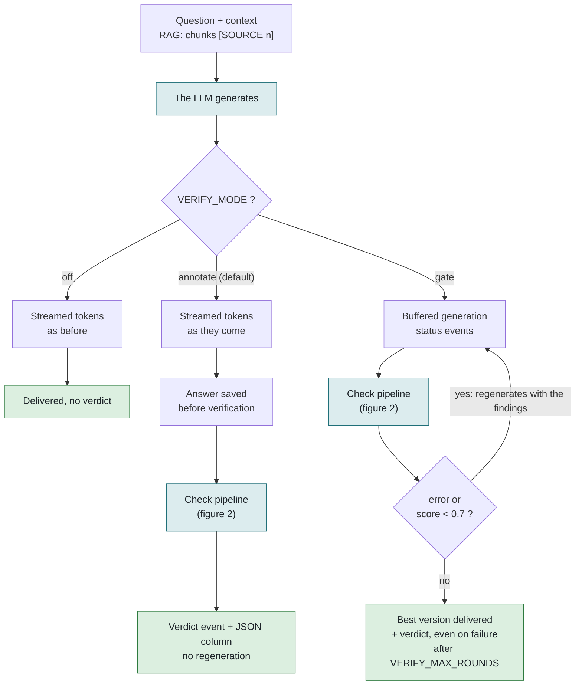
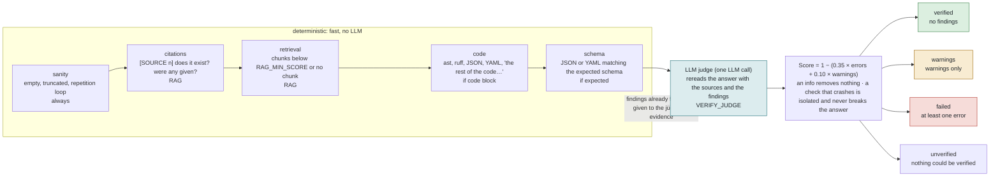
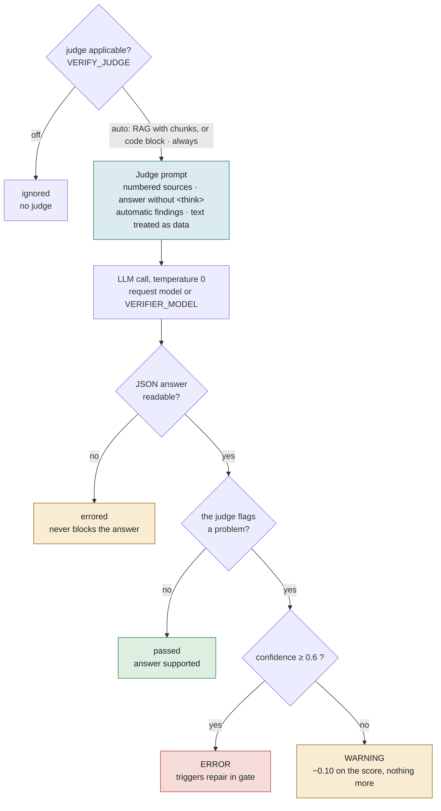

# AgentRAG answer verification

Every chat and RAG chat answer goes through deterministic checks, then optionally through an LLM judge, before or after it is delivered depending on the mode.

## 1. From prompt to delivered answer

In `annotate`, the text does not wait for verification. In `gate`, nothing is shown before the checks finish, and each repair round gives the model its previous answer back with the concrete list of problems.

## 2. The checks, in order

The cheap checks run first. The judge comes last, because it can rely on what they already found (for example "the syntax is invalid on line 3") instead of rediscovering it.

## 3. The LLM judge: when it speaks, when it blocks

The judge can only block an answer when it is sure of itself. If it gets the format wrong, if it goes down or if it hesitates, the answer is delivered and the doubt shows up only in the verdict.

## What each setting changes

| Variable | Effect on verification |
|---|---|
| `VERIFY_MODE` | `off`: nothing. `annotate`: immediate text, verdict afterwards. `gate`: delayed text, but repaired before delivery. |
| `VERIFY_JUDGE` | `off`: deterministic checks only. `auto`: judge if RAG with chunks or code. `always`: judge on everything. |
| `VERIFY_MAX_ROUNDS` | In `gate` only: maximum number of regenerations. `0` verifies without repairing. |
| `RAG_MIN_SCORE` | Relevance threshold for chunks. Below it, a weak-retrieval warning. |